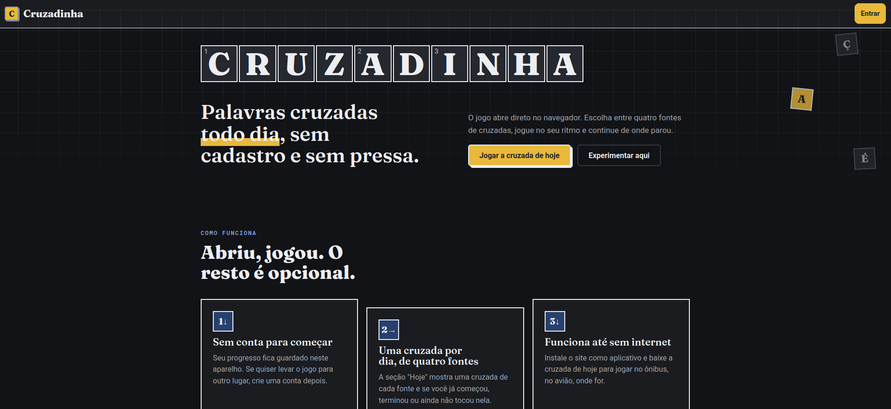
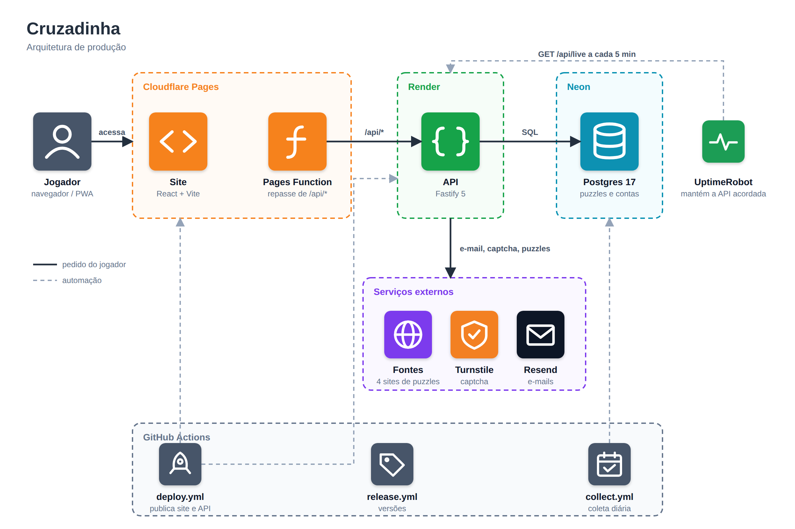

# Cruzadinha

[](https://cruzadinha.app.br)

[](https://github.com/BrunoYTanaka/cruzadinha/actions/workflows/ci.yml)
[](https://github.com/BrunoYTanaka/cruzadinha/actions/workflows/deploy.yml)
[](https://github.com/BrunoYTanaka/cruzadinha/releases)
[](LICENSE)

**Site:** <https://cruzadinha.app.br>

Site de palavras cruzadas que reúne puzzles de sites existentes numa interface limpa e fácil de usar. Cada site de origem tem uma UI/UX própria; o Cruzadinha entrega uma experiência única de jogo: tabuleiro, teclado, dicas e navegação, em tema claro ou escuro, com o progresso salvo no aparelho ou, com conta, entre dispositivos.

## Stack

Monorepo em npm workspaces, tudo em TypeScript (modo estrito):

| Pacote                                   | Descrição                                                               |
| ---------------------------------------- | ----------------------------------------------------------------------- |
| `apps/api` (`@cruzadinha/api`)           | API em Fastify 5, configurada só por variáveis de ambiente (validadas). |
| `apps/web` (`@cruzadinha/web`)           | Site em React 19 + Vite 8, estado de servidor com TanStack Query.       |
| `packages/shared` (`@cruzadinha/shared`) | Schemas Zod e tipos compartilhados entre API e web.                     |

| Camada                | Tecnologias                                                                                                                                                                                                                                                                                                                                                                                                                |
| --------------------- | -------------------------------------------------------------------------------------------------------------------------------------------------------------------------------------------------------------------------------------------------------------------------------------------------------------------------------------------------------------------------------------------------------------------------- |
| **Site**              |        |
| **API**               |     |
| **Linguagem**         |                                                                                                                                                                                           |
| **Banco de dados**    |                                                                                                          |
| **Testes**            |                                                                             |
| **Qualidade**         |                                                                                                                              |
| **Hospedagem e CI**   |                                                               |
| **Serviços externos** |                                                                                                                                                                                                            |

## Infraestrutura



O detalhe de cada peça está em [`docs/deploy.md`](docs/deploy.md).

## Pré-requisitos

- [Node.js](https://nodejs.org/) 24 (a versão está em `.nvmrc`; com nvm, rode `nvm use`)
- npm (vem com o Node.js)
- [Docker](https://docs.docker.com/get-docker/) com Compose, para o ambiente local com Postgres

## Como rodar

```sh
git clone https://github.com/BrunoYTanaka/cruzadinha.git
cd cruzadinha
nvm use
npm ci              # instala todos os workspaces e ativa os Git hooks
cp .env.example .env
```

### Com Docker Compose

Sobe o Postgres e a imagem da API:

```sh
docker compose up -d
curl localhost:3000/api/health
```

### Em modo de desenvolvimento

Com o Postgres rodando (por exemplo `docker compose up -d db`), em terminais separados:

```sh
npm run dev -w @cruzadinha/api   # API com reload, lê o .env da raiz
npm run dev -w @cruzadinha/web   # site com Vite
```

O Vite encaminha `/api` para `API_PROXY_TARGET` (padrão `http://localhost:3000`). As variáveis disponíveis estão documentadas em `.env.example`.

## Comandos

Rode a partir da raiz do repositório:

| Comando                                                          | O que faz                                                                         |
| ---------------------------------------------------------------- | --------------------------------------------------------------------------------- |
| `npm ci`                                                         | Instala as dependências de todos os workspaces.                                   |
| `npm run dev -w @cruzadinha/api`                                 | Sobe a API em modo watch.                                                         |
| `npm run dev -w @cruzadinha/web`                                 | Sobe o site com o servidor de desenvolvimento do Vite.                            |
| `npm run format` / `npm run format:check`                        | Formata ou verifica a formatação com Prettier.                                    |
| `npm run lint`                                                   | Roda o ESLint.                                                                    |
| `npm run check:ids` / `npm run check:ids:remote`                 | Falha se `specs/`, `DDE` ou `ERD` repetem número (`:remote` compara com a main).  |
| `npm run typecheck`                                              | Verifica os tipos em todos os workspaces.                                         |
| `npm test`                                                       | Roda os testes unitários em todos os workspaces.                                  |
| `npm run test:int`                                               | Roda os testes de integração com Postgres em container (exige Docker).            |
| `npm run db:migrate -w @cruzadinha/api`                          | Aplica as migrações do banco.                                                     |
| `npm run db:seed -w @cruzadinha/api`                             | Cria o usuário de teste do `.env` e um puzzle de exemplo (só em desenvolvimento). |
| `npm run cli -w @cruzadinha/api -- users create --email <email>` | Cria uma conta, mesmo com o cadastro fechado (a senha é pedida sem eco).          |
| `npm run cli -w @cruzadinha/api -- puzzles collect`              | Guarda o puzzle do dia de cada fonte e o histórico que faltar.                    |
| `npm run build`                                                  | Gera o build de todos os workspaces.                                              |

Para rodar um único arquivo de teste, entre no workspace: `cd apps/api && npx vitest run src/config.test.ts`.

Os Git hooks rodam `lint-staged` no pre-commit e, no pre-push, a checagem de números repetidos contra `origin/main`, o `typecheck` e os testes. A CI repete a checagem de números repetidos, a formatação, lint, typecheck, testes e build a cada push, roda os testes de integração e os testes end-to-end (Playwright, com o seed de desenvolvimento) e também gera a imagem Docker da API. A API aplica as migrações pendentes do banco ao subir.

## Versões

A API e o site têm versões próprias (`MAJOR.MINOR.PATCH`), calculadas sozinhas a partir dos tipos de commit: `fix` sobe o patch, `feat` sobe o minor. Cada merge na `main` atualiza um pedido de lançamento; aceitá-lo cria as tags, os registros de mudanças e publica só a parte que ganhou versão nova. Números e registros nunca são editados à mão.

Como funciona, com exemplos e como reverter: **[docs/versionamento.md](docs/versionamento.md)**.

## Produção

O site roda no Cloudflare Pages, a API no Render e o banco no Neon, com custo zero. O roteiro para criar, publicar, verificar e manter o ambiente está em [docs/deploy.md](docs/deploy.md).

## Contribuindo

O projeto segue um fluxo orientado a especificações com o [GitHub Spec Kit](https://github.com/github/spec-kit): cada funcionalidade tem sua pasta em `specs/` e os princípios do projeto ficam em `.specify/memory/constitution.md`. Commits seguem [Conventional Commits](https://www.conventionalcommits.org/pt-br/v1.0.0/).

## Licença

Distribuído sob a licença MIT. Veja [LICENSE](LICENSE).

Os puzzles pertencem às suas respectivas fontes; este projeto não é afiliado ao O Globo nem ao Público.
