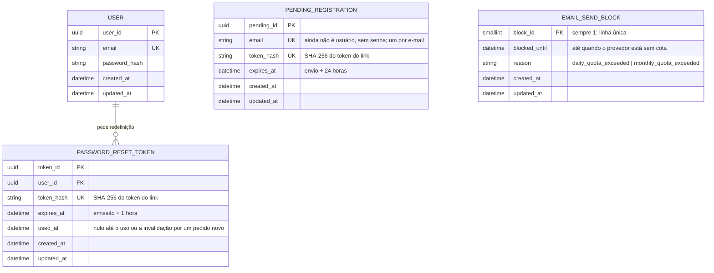

`PENDING_REGISTRATION` não tem chave estrangeira: vira um `USER` quando o link é aberto (a linha é apagada na mesma transação em que o usuário é criado). `EMAIL_SEND_BLOCK` também não se liga a nenhuma entidade.
